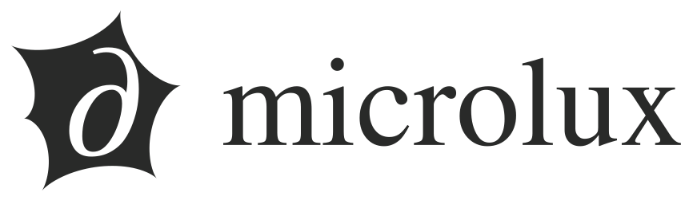

<picture>
  <source media="(prefers-color-scheme: dark)" srcset="https://raw.githubusercontent.com/CoastEgo/microlux/master/docs/_static/wordmark-light.svg">
  
</picture>

[](https://github.com/CoastEgo/microlux/actions/workflows/run_test.yml)
[](https://coastego.github.io/microlux/)
[](https://opensource.org/licenses/MIT)
---

`microlux` is a <a href='https://github.com/jax-ml/jax'>JAX</a>-based package that can calculate the binary lensing light curve and its derivatives both efficiently and accurately. We use modified adaptive contour integration based on <a href='https://github.com/valboz/VBBinaryLensing'>`VBBinaryLensing`</a>.
With the access to the gradient, we can use more advanced algorithms for microlensing modeling, such as Hamiltonian Monte Carlo (HMC) in <a href='https://num.pyro.ai/en/latest/mcmc.html#numpyro.infer.hmc.NUTS'>`numpyro`</a>.


## Installation

``` bash
pip install microlux
```
or you can install this package from source for development. 
``` bash 
git clone https://github.com/CoastEgo/microlux.git
cd microlux
pip install -e .
```

## Quick Start

Compute a binary-lens light curve:

```python
import jax.numpy as jnp
from microlux import binary_mag

# t0, u0, tE, rho, q, s, alpha in degrees
params = jnp.array([0.0, 0.1, 1.0, 0.01, 0.2, 0.9, 270.0])
times = jnp.linspace(-1.0, 1.0, 1000)

mag = binary_mag(*params, times, tol=1e-3, retol=1e-3)
```

## Documentation
The [documentation](https://coastego.github.io/microlux/) includes runnable
examples for parallax, orbital motion, and real-event fitting.


  
## Citation

`microlux` is open-source software licensed under the MIT license. If you use this package for your research, please cite our paper:

- A differentiable binary microlensing model using adaptive contour integration method: <a href='https://arxiv.org/abs/2501.07268'>in arXiv</a> and <a href= 'https://iopscience.iop.org/article/10.3847/1538-3881/adb1b2'>in AJ </a>.

``` bibtex
@article{ren2025microlux,
       author = {{Ren}, Haibin and {Zhu}, Wei},
        title = "{A Differentiable Binary Microlensing Model Using Adaptive Contour Integration Method}",
      journal = {The Astronomical Journal},
         year = 2025,
       volume = {169},
       number = {3},
          eid = {170},
        pages = {170},
          doi = {10.3847/1538-3881/adb1b2},
       adsurl = {https://ui.adsabs.harvard.edu/abs/2025AJ....169..170R},
}
```
